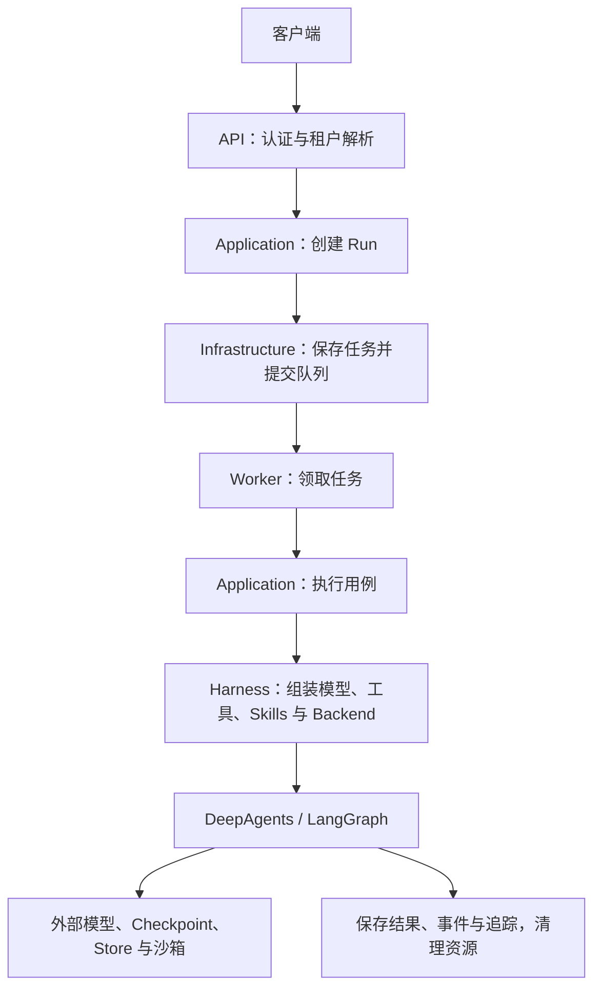

# DeepAgent Enterprise Harness

面向多租户 Agent 应用的企业级 Python 脚手架，采用 DDD 分层与模块化单体组织代码，提供 API、后台 Worker、Agent 定义以及外部系统适配的工程边界。

DeepAgents 负责 Agent Runtime，Harness 负责模型、工具、Skills、Middleware、Backend 和运行策略的组装。API 与 Worker 使用同一代码库，可分别部署。

## 当前状态

项目处于脚手架阶段：目录、基础模型、ABC 契约和最小启动入口已经准备，业务能力按模块逐步接入。

| 模块 | 当前内容 | 尚需接入 |
| --- | --- | --- |
| 工程配置 | Python 3.12、uv、`pyproject.toml`、`uv.lock` | 持续集成与发布流程 |
| API | FastAPI 应用工厂、生命周期、版本化路由骨架、`GET /health` | 业务端点、认证、租户解析、SSE / WebSocket |
| Bootstrap | Settings、Container、组装入口 | 外部客户端、连接池与应用服务绑定 |
| Domain | 严格数据模型、Principal、RunContext、Run 等基础类型 | 具体业务规则与状态流转 |
| Application | Agent / Run 用例与外部能力 ABC 契约 | 用例实现和事务编排 |
| Agents | 四个 Python 定义模板、独立 Prompt 和 Skills、注册表 | 模型 Provider、运行图构建和委派执行 |
| Middleware / Backend | 模块文件、部分 ABC 扩展契约 | 权限、预算、审计、文件访问和路由实现 |
| Infrastructure | 数据库、队列、Checkpoint、模型、沙箱、Langfuse 扩展位置 | 外部系统适配与连接管理 |
| Worker | 独立命令入口，输出提示后退出 | 队列消费、任务执行、取消、清理 |
| 部署与质量 | Dockerfile、Compose、分层测试目录、结构检查脚本 | 部署环境验证与业务测试 |

当前可用的应用端点是 `/health`。业务路由模块尚未声明操作，Agent 执行、数据库持久化、队列消费和远程沙箱尚未连通。身份依赖在未配置认证适配器时返回 `501`；租户模型和接口本身不代表租户隔离已经完成。

## 技术选型

| 技术 | 用途 |
| --- | --- |
| Python 3.12 | 项目运行环境，版本范围为 `>=3.12,<3.13` |
| uv | Python 环境、依赖安装与锁文件管理 |
| Pydantic v2 | 严格模型、DTO 和数据校验 |
| pydantic-settings | 环境变量与本地配置解析 |
| ABC / abstractmethod | 应用用例、仓库、运行时和 Provider 契约 |
| FastAPI / Uvicorn | HTTP 接口与 ASGI 服务 |
| DeepAgents / LangChain / LangGraph | Agent 定义适配、模型与图执行集成 |
| SQLAlchemy | 持久化适配预留 |
| PostgreSQL / Redis | 配置中预留的数据存储和缓存 / 队列服务地址 |
| Langfuse | 可观测性适配预留 |
| pytest / unittest / Ruff / mypy | 测试、代码规范与严格类型检查 |

依赖范围写在 `pyproject.toml`，解析结果记录在 `uv.lock`。日常安装使用锁文件，升级时显式更新并执行兼容性检查。安装依赖不会自动启用对应业务模块。

## 快速开始

在项目根目录执行以下命令，需要预先安装 uv，并允许访问依赖索引。

```powershell
uv python install 3.12
uv sync --locked --group dev
```

首次初始化配置时执行以下命令；已有 `.env` 时保留现有内容：

```powershell
if (-not (Test-Path .env)) { Copy-Item .env.example .env }
```

启动 API：

```powershell
uv run --locked harness-api
```

| 地址 | 用途 |
| --- | --- |
| http://127.0.0.1:8000/health | 进程健康检查，返回 `{"status":"ok"}` |
| http://127.0.0.1:8000/docs | OpenAPI 交互文档 |
| http://127.0.0.1:8000/openapi.json | OpenAPI 定义 |

另一个终端可执行 Worker 入口：

```powershell
uv run --locked harness-worker
```

当前 Worker 输出准备提示后退出，不会常驻消费任务。最小 API 启动不连接数据库、Redis 或模型服务；`/health` 也不检查这些外部依赖。

命令行入口分别映射到 `agent_platform.api.app:main` 和 `agent_platform.workers.run_worker:main`。`apps/api/main.py`、`apps/worker/main.py` 是薄入口，不放业务逻辑。

## 配置管理

`bootstrap/settings.py` 中的 `Settings` 读取环境变量及根目录 `.env`，配置项使用 `HARNESS_` 前缀。

| 环境变量 | 作用 | 默认值 |
| --- | --- | --- |
| `HARNESS_APP_NAME` | API 应用名称 | `DeepAgent Enterprise Harness` |
| `HARNESS_ENVIRONMENT` | `development` / `test` / `production` | `development` |
| `HARNESS_HOST` | API 监听地址 | `127.0.0.1` |
| `HARNESS_PORT` | API 监听端口 | `8000` |
| `HARNESS_DATABASE_URL` | 数据库连接配置 | `postgresql+psycopg://localhost/agent_platform` |
| `HARNESS_REDIS_URL` | Redis 连接配置 | `redis://localhost:6379/0` |
| `HARNESS_LANGFUSE_ENABLED` | 可观测性功能开关预留 | `false` |

`.env.example` 中的模型和 Langfuse 凭证字段用于后续 Provider 配置。当前适配器尚未实现，仅填写变量不会发起模型调用或启用追踪。实现时应明确其读取位置及生命周期。

应用设置负责把环境字符串转换为配置类型；领域模型采用严格校验。两类对象承担不同的数据边界职责。

## 目录职责

以下路径均相对项目根目录。

| 路径 | 职责 |
| --- | --- |
| `apps/api/` | API 启动入口与镜像构建 |
| `apps/worker/` | Worker 启动入口与镜像构建 |
| `src/agent_platform/bootstrap/` | 配置读取、依赖组装与生命周期 |
| `src/agent_platform/api/` | HTTP 路由、请求响应 Schema、依赖注入与 HTTP Middleware |
| `src/agent_platform/domain/` | 租户、Agent、任务、会话、Skills、工具和沙箱领域类型 |
| `src/agent_platform/application/` | 应用用例、DTO 与外部能力 Ports |
| `src/agent_platform/harness/agents/` | Agent 契约、注册表、工厂和四个 Agent 模板 |
| `src/agent_platform/harness/middleware/` | Agent 执行阶段的权限、预算、审批、审计与保护扩展 |
| `src/agent_platform/harness/tools/` | 通用工具与搜索、数据库、文件、代码执行、MCP 扩展 |
| `src/agent_platform/harness/skills/` | Skills 加载、解析、注册和校验扩展 |
| `src/agent_platform/harness/backends/` | Agent 文件访问、租户范围和组合 Backend 扩展 |
| `src/agent_platform/harness/runtime/` | DeepAgents 适配、图构建和执行扩展 |
| `src/agent_platform/harness/policies/` | 工具权限、Skill 权限与执行限制 |
| `src/agent_platform/infrastructure/` | 持久化、Checkpoint、Store、队列、缓存、模型、沙箱、对象存储、密钥与观测适配 |
| `src/agent_platform/workers/` | 任务、沙箱和资源清理 Worker 模块 |
| `tests/` | 单元、集成、契约、端到端、安全和多租户测试 |
| `evals/` | 数据集、评估用例、评分器与回归评估位置 |
| `migrations/` | 数据库迁移位置 |
| `infra/` | Docker、Compose、Kubernetes、Helm 与 Terraform 部署文档位置 |
| `docs/` | 架构、决策记录、API、安全与运维文档 |
| `scripts/` | 结构检查等工程辅助脚本 |

目录或文件存在表示扩展位置已经确定，具体实现范围以代码和本页“当前状态”为准。

## 模块关系与执行流程

### 当前启动过程

`harness-api` 启动 Uvicorn，调用 `create_app()` 创建 FastAPI 并注册路由。应用生命周期启动时，`build_container()` 创建 Container，保存到 `app.state.container`；应用关闭时移除该对象。

| 文件 | 当前行为 | 后续职责 |
| --- | --- | --- |
| `bootstrap/settings.py` | 解析应用设置 | 维护配置边界 |
| `bootstrap/container.py` | 保存 Settings | 持有应用级依赖和服务 |
| `bootstrap/wiring.py` | 创建 Container | 选择实现、注入构造依赖 |
| `bootstrap/lifespan.py` | 初始化与移除 Container | 创建并释放客户端和连接池 |
| `api/dependencies.py` | 提供 Container 读取与身份依赖声明 | 向端点注入组件及可信身份 |

当前 `/health` 直接返回状态，不调用应用服务或 Agent。业务端点接入后，可通过 `CurrentContainer` 取得组装结果；应用服务应接收明确的构造依赖，避免在业务内部反复查找容器。

### 目标任务链路（待接入）



API 处理请求，Application 安排业务步骤，Domain 提供模型与规则，Infrastructure 操作外部系统，Harness 组装 Agent 执行能力。Domain 不需要作为独立运行服务部署。

### 依赖边界

- Domain 不导入 FastAPI、SQLAlchemy、DeepAgents 等外部框架。
- Application 使用 Domain 和 ABC Ports，不直接创建数据库连接或沙箱客户端。
- Infrastructure 实现外部能力接口，Harness 负责 Agent SDK 适配和执行组装。
- Bootstrap 选择具体实现并注入应用服务，API 和 Worker 保持薄入口。
- SDK 所需的开放类型限制在适配边界，业务数据优先使用明确的 Pydantic 类型。

## Agent 开发约定

### 现有模板

| Agent | 用途 | 专属 Skills 目录 |
| --- | --- | --- |
| `orchestrator` | 主 Agent，声明可委派的三个自定义子 Agent | `skills/task-planning/` |
| `researcher` | 证据分析与来源评估 | `skills/web-research/`、`skills/source-evaluation/` |
| `coder` | 编码与测试任务 | `skills/code-debugging/`、`skills/test-writing/` |
| `reviewer` | 代码审查 | `skills/code-review/` |

这些是定义模板，不代表联网检索、代码执行或审查流程已经实现。每个 Agent 可独立选择模型、Prompt、工具、中间件、Backend 和 Skills。

### 每个 Agent 的文件

| 文件 | 作用 |
| --- | --- |
| `definition.py` | 继承 `AgentDefinition`，声明名称、模型选择、资源目录、工具、中间件、Backend profile 和子 Agent |
| `system_prompt.md` | 独立维护该 Agent 的系统提示词 |
| `tools.py` | 选择和组装该 Agent 的工具 |
| `middleware.py` | 选择和组装该 Agent 的中间件 |
| `backend.py` | 声明该 Agent 使用的 Backend profile |
| `skills/<skill-name>/SKILL.md` | 该 Agent 的专属 Skill 指令与资源入口 |

Agent 使用 Python 定义和组装，允许不同模型、不同构造参数和动态逻辑。通用工具、中间件及 Backend 实现在公共模块维护，Agent 目录负责选择与配置。

`AgentRegistry` 已提供名义类型检查、重复名称检查及子 Agent 关系校验；`AgentFactory` 当前是 ABC，图构建由后续 Runtime 适配实现。

### 新增 Agent 的步骤

1. 在 `harness/agents/` 创建新目录，准备定义、Prompt、工具、中间件、Backend 与 Skills 文件。
2. 继承 `AgentDefinition`，实现要求的属性和方法，通过 ModelProvider 解析独立模型配置。
3. 在组装阶段构造定义并注册到 `AgentRegistry`；若需要委派，在父 Agent 的 `children` 中显式声明。
4. 接入 AgentFactory 时，显式解析该 Agent 的 Skills、权限和 Backend，构造自定义子 Agent。
5. 增加定义解析、资源加载和权限测试；真实模型行为放入集成测试或 Evals。

## Skills 与子 Agent

自定义子 Agent 默认使用自己的 Skills，不自动合并父 Agent 的 Skills。主 Agent 声明子 Agent 只表示允许委派，不表示共享工具、凭证或权限。

公共 Skills 需要显式引用和授权；后续出现稳定复用需求时，再增加共享资源目录或受控 Registry。租户上传的 Skills 应经过校验、版本管理和访问检查，其中脚本的执行另受沙箱和工具权限约束。

DeepAgents 默认 `general-purpose` 子 Agent 的继承行为交给所锁定版本的框架处理。接入或升级 Runtime 时，必须用契约测试核对默认子 Agent、自定义子 Agent 及相关执行模式的 Skills 行为，避免自行复制一套继承规则。当前 Skills 解析及 Runtime 适配仍是扩展位置。

## Middleware、Backend 与沙箱

| 能力 | 位置 | 责任 |
| --- | --- | --- |
| HTTP Middleware | `api/middleware/` | 认证、租户解析、请求 ID、限流、HTTP 异常处理 |
| Agent Middleware | `harness/middleware/` | 工具权限、预算、调用审计、人工审批、输入输出保护、PII 与追踪上下文 |
| DeepAgents Backend | `harness/backends/` | Agent 文件访问、路由、状态和持久记忆集成 |
| Sandbox Provider | `infrastructure/sandbox/` | 创建、连接、执行、取消和销毁实际执行环境 |

Backend 向 Agent 暴露受控能力，Sandbox Provider 管理实际执行环境。业务数据库 Repository 负责业务持久化，两者职责独立。

远程沙箱接入应通过 `SandboxProvider` ABC，统一处理鉴权、超时、取消、文件传输与清理。Docker、远程 HTTP、Kubernetes 均已预留适配文件，目前没有可用 Provider 实现。API 与 Worker 的 Dockerfile 用于部署服务，不等于代码执行沙箱。

## 多租户约束

`Principal` 包含 `tenant_id`、`project_id`、`user_id`；`RunContext` 增加 `run_id`、`thread_id`、`trace_id`、Agent 版本和策略版本。`checkpoint_thread` 将租户、项目、用户及线程标识组合为命名空间。

这些模型用于传递明确上下文，实际授权仍需要各层执行：

| 边界 | 接入时必须保证 |
| --- | --- |
| API | 从认证身份和成员关系取得可信租户，不直接信任请求中的租户标识 |
| Application | 每个用例显式接收可信 Principal 或 RunContext |
| Repository | 所有读写限定租户范围，按需求增加 PostgreSQL RLS |
| Checkpoint / Store / Backend | 隔离线程、记忆、路径与访问范围 |
| Tools / MCP / Skills | 显式授权每次调用和资源访问 |
| Queue / Cache | 任务载荷、状态、键和读取权限绑定租户 |
| Sandbox | 隔离工作目录、凭证、进程、网络和资源额度 |
| Observability | 关联租户与 Run，控制敏感字段及追踪数据访问 |

应用级 Container 可共享无租户状态的配置和连接池。租户身份、用户凭证、Run 上下文以及租户专属客户端放在请求或运行作用域内，不能保存在跨租户共享的可变对象中。

## 类型与接口规范

领域数据模型继承 `StrictModel`，使用 Pydantic v2 配置：

```python
model_config = ConfigDict(
    strict=True,
    extra="forbid",
    frozen=True,
    validate_default=True,
)
```

- 使用 `model_validate`、`model_validate_json`、`model_dump`、`model_dump_json` 等 v2 接口。
- 外部能力优先定义 ABC，通过继承实现明确契约，减少鸭子类型依赖。
- SDK 自身的 Protocol、TypedDict 与必要的 `Any` 在适配边界处理。
- 新增 ORM 模型使用 SQLAlchemy 的 `DeclarativeBase`、`Mapped`、`mapped_column`。
- 明确环境字符串、HTTP JSON、领域对象和持久化对象之间的转换位置。

## 测试与检查

```powershell
uv run --locked python scripts/check_structure.py
uv run --locked python -m unittest discover -s tests/unit -v
uv run --locked pytest
uv run --locked ruff check .
uv run --locked mypy
```

结构脚本检查源码语法、Domain 框架依赖边界和四个 Agent 的资源文件。现有单元测试覆盖严格模型、不可变性、标识校验、Repository ABC 与上下文序列化，不代表完整业务或租户隔离已经验证。

| 目录 | 后续测试重点 |
| --- | --- |
| `tests/unit/` | 模型、定义解析、权限策略与局部逻辑 |
| `tests/integration/` | Runtime、数据库、队列、Checkpoint 和沙箱集成 |
| `tests/contract/` | 自定义 Backend、Provider 和 SDK 兼容性 |
| `tests/e2e/` | 创建任务、委派、执行、恢复、取消与结果读取 |
| `tests/security/` | 越权、路径穿越、凭证泄露和执行边界 |
| `tests/multi_tenant/` | 跨租户数据、线程、文件与沙箱隔离 |
| `evals/` | Agent 输出质量、工具选择与关键任务回归 |

## 容器运行

需要 Docker 及 Compose 插件，在根目录执行：

```powershell
docker compose up --build api
```

API 映射宿主机 `8000` 端口，镜像内监听 `0.0.0.0`。Worker 使用独立 profile：

```powershell
docker compose --profile worker run --build --rm worker
```

当前 Compose 只定义 API 和 Worker，没有数据库、Redis 或沙箱服务，也不会自动注入宿主机 `.env` 到容器。外部连接信息和凭证应在实际部署时显式注入。

当前 Dockerfile 在镜像构建时执行 `uv sync`，尚未复制锁文件并使用锁定安装。生产发布前需补齐锁定构建、镜像版本固定和部署验证。

## 依赖升级与版本管理

```powershell
uv lock --upgrade
uv sync --locked --group dev
```

升级后执行静态检查和相应测试，尤其检查 DeepAgents Adapter、Backend、Skills 加载及子 Agent 的兼容性。Python 3.12 和 Pydantic v2 的主要版本约束应保留。

提交源码、文档、测试、部署配置、`pyproject.toml`、`uv.lock` 和无密钥的 `.env.example`。本地 `.env`、虚拟环境、缓存、IDE 配置、构建产物和真实凭证不进入版本管理。

## 后续接入顺序

1. 实现模型 Provider、AgentFactory 与 DeepAgents Runtime 适配，验证主 Agent 和一个独立子 Agent 的执行。
2. 实现任务 Repository、Checkpoint 和基础 Run 用例，接入业务端点与依赖组装。
3. 实现认证、成员关系和各层租户约束，通过多租户测试后开放业务接口。
4. 接入队列和常驻 Worker，补齐任务取消、恢复、超时与资源清理。
5. 按需求实现远程沙箱、Langfuse、审批、预算和审计，并补充 Evals 与运维流程。

## 相关文档

- [架构设计](deepagents_enterprise_harness_architecture.md)
- [脚手架边界说明](docs/architecture/scaffold.md)

其他文档和测试子目录包含扩展占位说明，接入对应模块时同步更新。
