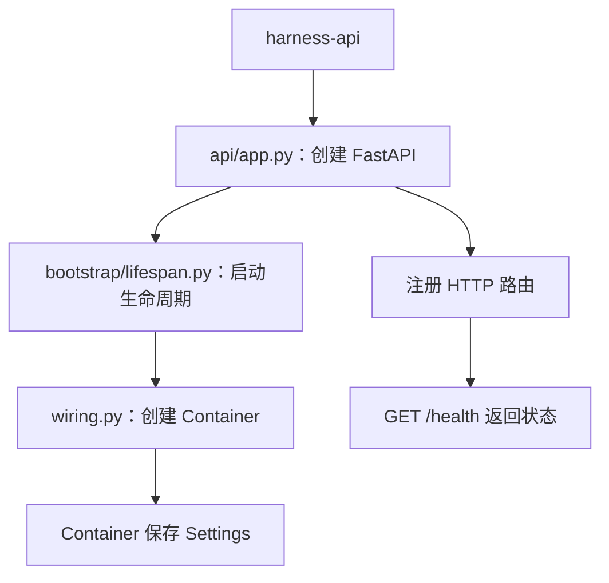
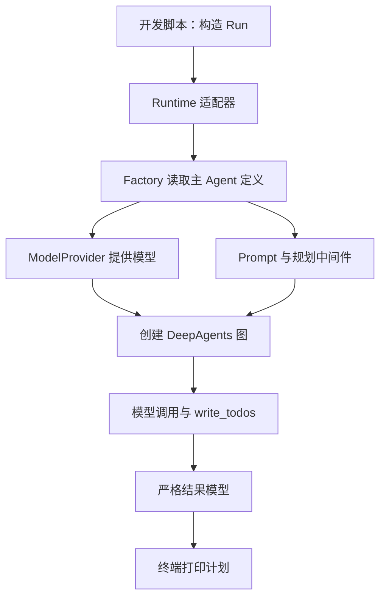
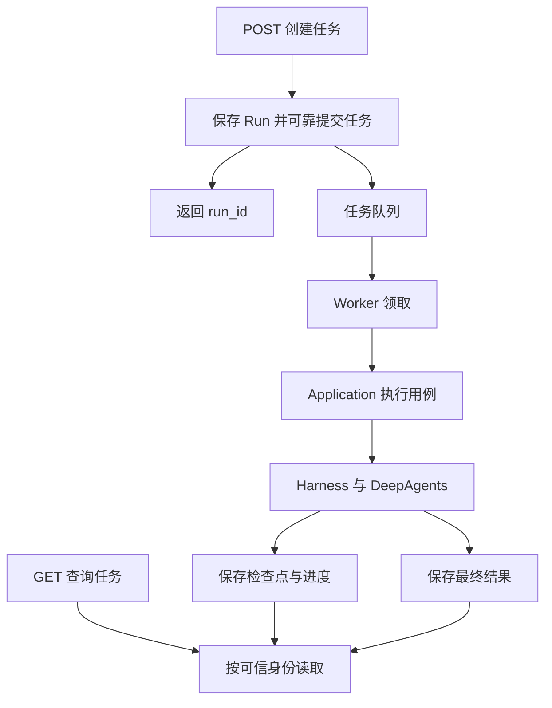

# 长任务规划开发指南

这份指南用于从现有脚手架开始，逐步实现任务规划、多步骤执行、状态保存和后台长任务。文中的新增文件、接口与链路属于开发计划，不表示已经实现。

先完成一个可验证的功能：**输入复杂目标，主 Agent 拆分任务，返回结构化计划清单。** 然后逐步增加工具执行、进度更新、持久化、Worker 和恢复机制。

## 1. 先区分四种能力

| 能力 | 示例 | 所需组件 |
| --- | --- | --- |
| 任务规划 | 将整理报告拆成几个步骤 | 模型、Prompt、规划中间件 |
| 多步骤执行 | 逐份读取资料并更新状态 | 工具、Agent 执行循环 |
| 状态保存 | 查询计划和已完成步骤 | Checkpointer、任务仓库 |
| 后台长任务 | 关闭网页后继续，进程中断后可恢复 | 队列、Worker、持久化、重试和恢复机制 |

第一阶段只完成任务规划。规划清单不是消息队列，也不是后台调度器。

当前项目已核对的 DeepAgents 版本为 0.7.32。0.7 系列的规划能力需要显式添加 `TodoListMiddleware`，它提供 `write_todos` 工具；不要假设创建 Agent 就会自动启用规划。依赖升级时重新检查官方文档和已安装 SDK。

## 2. 用一个具体任务贯穿开发

开发输入示例：

> 阅读我提供的三份产品说明，确定比较维度，逐份提取信息，最后生成比较报告。先生成计划，不执行。

第一阶段期望得到类似下面的清单：

```json
{
  "todos": [
    {"content": "确定比较维度", "status": "pending"},
    {"content": "提取三份产品说明的信息", "status": "pending"},
    {"content": "整理差异和信息缺口", "status": "pending"},
    {"content": "生成比较报告并核对依据", "status": "pending"}
  ]
}
```

这是期望的数据形态，不是当前已有的 API 返回格式。生成了计划，不等于完成了计划里的工作；第一阶段不应把业务步骤标为已完成。

先将三份说明直接随请求提供，避免同时排查联网、文件读取和模型执行问题。

## 3. 先认识目录，不需要通读所有文件

以下路径均相对 `src/agent_platform/`。

| 目录 | 通俗理解 | 在规划功能中的工作 |
| --- | --- | --- |
| `domain/` | 定义业务数据和规则 | 请求、计划结果、状态与上下文 |
| `application/` | 安排一项业务的处理步骤 | 接收目标，调用规划能力，返回结果 |
| `harness/` | 组装并运行 Agent | 模型选择、Prompt、工具、中间件与 SDK 调用 |
| `infrastructure/` | 连接具体外部系统 | 模型服务、数据库、Checkpoint、队列和沙箱 |
| `bootstrap/` | 将组件连接起来 | 配置、创建 Provider、Factory、Runtime 和应用服务 |
| `api/` | 接收 HTTP 请求 | 输入校验、可信身份、调用应用服务、响应转换 |
| `workers/` | 在后台处理任务 | 领取、执行、重试、取消和清理 |

目录不是必须依次经过的站点。Domain 中的 `Run` 是数据对象，Application 可以创建它，Runtime 可以读取它，Repository 可以保存它；无需额外部署一个 Domain 服务。

依赖原则：Domain 不依赖 Web、数据库或 Agent SDK；Application 依赖明确的 ABC Ports；外部适配器实现接口；Bootstrap 选择实现并组装。

## 4. 当前代码实际如何流转

### 4.1 已接通的 API 启动过程



`main()` 启动 Uvicorn，Uvicorn 调用 `create_app()`。生命周期启动时创建 Container，放进 `app.state.container`；关闭时移除。

当前 `/health` 直接返回 `{"status":"ok"}`，不调用 Container 内的业务服务，也不调用 Agent。

### 4.2 哪些文件还没有接通

| 路径 | 当前情况 |
| --- | --- |
| `bootstrap/container.py` | 只保存 Settings，没有规划服务或 Runtime |
| `bootstrap/wiring.py` | 只创建 Container，尚未绑定外部实现 |
| `harness/agents/orchestrator/definition.py` | 主 Agent 定义模板，尚未由启动流程组装 |
| `harness/agents/registry.py` | 提供注册和校验，但不会自动发现并注册 Agent |
| `harness/agents/factory.py` | ABC 契约，没有构图实现 |
| `harness/runtime/deepagents_adapter.py` | SDK 集成位置，尚无执行实现 |
| `harness/agents/orchestrator/middleware.py` | 返回空列表，尚未启用规划 |
| `harness/agents/orchestrator/skills/` | 有资源文件，不代表 Runtime 已加载 |
| `api/routes/v1/runs.py` | 路由骨架，没有创建任务操作 |
| `workers/run_worker.py` | 输出提示后退出，不消费队列 |

### 4.3 Container 为什么存在

| 文件 | 职责 |
| --- | --- |
| `settings.py` | 定义和读取设置 |
| `container.py` | 保存组装好的应用组件 |
| `wiring.py` | 决定使用哪些实现，传入构造依赖 |
| `lifespan.py` | 决定何时创建、何时释放资源 |
| `api/dependencies.py` | 将组件和可信身份提供给端点 |

例如，应用服务依赖 `AgentRuntime` ABC，Bootstrap 将具体的 DeepAgents Runtime 实现传入服务。这样替换运行时或写测试时，不必在业务代码中修改模型客户端和 SDK 调用。

业务服务应接收明确的构造依赖，避免每个方法都到 Container 中查找组件。

## 5. 第一步：确认开发环境

在项目根目录运行：

```powershell
uv sync --locked --group dev
uv run --locked python scripts/check_structure.py
uv run --locked python -m unittest discover -s tests/unit -v
uv run --locked harness-api
```

访问 `http://127.0.0.1:8000/health`。

验收：依赖安装成功，基础测试通过，健康检查正常，并能在 `api/app.py` 中设置断点。

这一阶段只验证工程，不接模型或数据库。

## 6. 第二步：先接通模型调用

阅读 `infrastructure/model_providers/factory.py`。现有 `ModelProvider` ABC 的方法是：

```python
def resolve(self, profile: str, context: RunContext) -> BaseChatModel:
    ...
```

它表达的要求是：提供模型配置名称和可信运行上下文，返回可调用的模型对象。

### 编码位置

建议新增 `infrastructure/model_providers/providers/openai.py`，编写继承 `ModelProvider` 的具体实现。使用其他模型服务时，相应增加 Provider 实现。

需要完成：

1. 定义模型名称、接口地址与凭证的读取方式。
2. 补充必要的 Settings 字段，凭证使用适当的敏感类型处理。
3. 解析模型 profile，创建模型客户端。
4. 返回满足 SDK 要求的 `BaseChatModel`。
5. 缺少配置、未知 profile 或连接失败时抛出清晰错误。

先使用本地开发配置，随后再接入租户专属凭证解析。凭证不得由模型生成或从模型工具参数中直接取得。

### 验收

用开发脚本单独调用模型，发送“请只回复：模型连接成功”。确认真实请求成功，再进入 Agent 组装。

先解决模型连接，再处理构图和 HTTP。不要同时引入三个排错层次。

## 7. 第三步：让主 Agent 获得规划能力

主要修改：

- `harness/agents/orchestrator/middleware.py`
- `harness/agents/orchestrator/system_prompt.md`
- `harness/agents/orchestrator/definition.py`

### 7.1 添加规划中间件

从 `langchain.agents.middleware` 导入 `TodoListMiddleware`，让主 Agent 的中间件选择结果包含 `TodoListMiddleware()`。

它提供任务清单，状态为 `pending`、`in_progress`、`completed`。`write_todos` 更新的是整份清单，不是追加单条记录；更新时需要保留仍然有效的任务。

项目已有 `ContextMiddleware` 类型约束。接入时检查 SDK 泛型兼容性，并运行 mypy，不用随意增加 `Any` 掩盖不兼容。

### 7.2 明确只规划的 Prompt

第一版要求 Agent：

1. 识别目标、输入资料和限制。
2. 拆成少量可操作、可检查的步骤。
3. 使用 `write_todos` 记录清单。
4. 只规划，不执行计划中的业务工作。
5. 不将尚未执行的工作标为完成。
6. 条件不足时指出缺口，不虚构材料和结果。

### 7.3 先缩小配置范围

先运行主 Agent，不组装三个自定义子 Agent。现有 `children` 声明了 `researcher`、`coder`、`reviewer`，第一版要显式处理这些声明，避免出现注册表缺少引用对象的问题。

同时检查 SDK 默认工具和默认子 Agent 的配置。`tools=[]` 不等于框架所有内置工具均已禁用。Prompt 是行为引导；若要强制禁止执行，需要在工具暴露或调用边界限制。

### 验收

能够解释模型、Prompt、中间件分别来自哪个文件；主 Agent 构图配置包含规划中间件。

## 8. 第四步：实现 Factory 和 Runtime

主要关注：

- `harness/agents/contracts.py`
- `harness/agents/factory.py`
- `application/ports/runtime.py`
- `harness/runtime/deepagents_adapter.py`

| 对象 | 职责 |
| --- | --- |
| `AgentDefinition` | 描述 Agent 使用什么配置 |
| `AgentFactory` | 将定义转换为可运行图 |
| `AgentRuntime` | 接收任务，调用图，整理结果 |

Factory 负责构建，Runtime 负责执行，不自己重复实现 Agent 循环。

### 8.1 先定义结构化结果

当前 `AgentRuntime.execute(run)` 返回 `str`，不足以表达可供 API 使用的任务计划。

建议在 Domain 中新增严格结果模型，例如 `domain/runs/planning.py`，让业务返回值至少包含：

| 模型或字段 | 建议约束 |
| --- | --- |
| `PlanItem.content` | 非空字符串 |
| `PlanItem.status` | 明确枚举或 Literal |
| `PlanningResult.answer` | 最终说明 |
| `PlanningResult.todos` | 严格类型的任务项序列 |

模型继承现有 `StrictModel`。容器字段是否可修改要单独考虑：`frozen=True` 不会递归冻结 list 或 dict；需要不可变集合时选择 tuple 等类型。

同步修改 Runtime 契约及实现，使返回值能够表达结构化结果。第一阶段先返回规划结果，持久化阶段再决定如何演进 `Run.result`，不要把 SDK 原始状态直接暴露为公共接口。

### 8.2 再实现具体工厂与适配器

1. 新增继承 `AgentFactory` 的具体工厂，例如 `harness/runtime/graph_builder.py` 中的实现。
2. 读取定义的模型、Prompt、工具与中间件。
3. 使用 `create_deep_agent` 构图。
4. 在 `deepagents_adapter.py` 中实现 `AgentRuntime`。
5. 使用异步图调用执行输入。
6. 提取消息与 `todos`，转换成项目自己的严格模型。
7. SDK 字典与开放类型保留在适配边界。

第一阶段尚不接 Skills 加载，不能假设目录里的 `SKILL.md` 已经生效。规划行为先由明确的 Prompt 和中间件验证；随后单独实现 Skills 加载、授权与兼容性测试。

### 验收

可以创建图，执行一次输入，返回经过 Pydantic 校验的规划结果。模型错误不能被包装成成功结果。

## 9. 第五步：命令行跑通规划

建议新增 `scripts/demo_planning.py`，依次完成：

1. 创建固定的本地开发 `RunContext`。
2. 创建模型 Provider。
3. 创建主 Agent 定义。
4. 创建 Factory 和 Runtime。
5. 构造现有 `Run`。
6. 调用 Runtime。
7. 输出结构化结果。

上下文由脚本创建，不能让模型决定租户、用户或线程身份。



验收标准：

- 多步骤输入生成可操作的计划。
- 观察到 `write_todos` 调用，而非只有自然语言编号列表。
- 返回结果通过严格校验。
- 计划中的业务工作没有被误标为完成。
- 模型连接失败时错误清晰。

此时已经完成第一个真实功能。计划质量允许用少量有代表性的输入评估，不要求模型每次生成完全相同的文字。

## 10. 第六步：接 Application、Container 和 HTTP

命令行成功后，再接 Web。

### 10.1 Application

建议新增 `application/runs/plan_task.py`，定义规划用例的 ABC 及具体实现位置。用例接收可信身份和请求，构造上下文，调用注入的 Runtime，并返回严格结果。

用例不创建模型客户端、不直接调用 `create_deep_agent`。

### 10.2 Bootstrap

在 `wiring.py` 中依次组装：模型 Provider、Agent 定义和注册表、Factory、Runtime、规划应用服务，最后创建 Container。

在 `container.py` 中声明清晰的成员类型。共享 Container 保存配置和不包含租户状态的组件；每个请求的 Principal、RunContext 通过参数传入。

在 `lifespan.py` 中管理客户端和连接池的创建、关闭。不要在模块导入时建立外部连接。

### 10.3 API

建议新增 `api/routes/v1/plans.py` 和对应 Schema，并在 v1 路由入口显式注册：

```text
POST /api/v1/plans
```

这个地址目前不存在。端点校验输入，取得可信身份和应用服务，调用用例，转换响应。

第一版是有明确超时限制的一次性规划请求，可直接等待结果；真正后台任务另接 Run API。

当前身份依赖会返回 `501`。本地测试可以使用仅测试环境生效的依赖覆盖；开放真实接口前必须实现认证与成员关系校验，不能直接信任请求中的 `tenant_id`。

### 验收

HTTP 返回结构化计划；非法输入被拒绝；模型失败转换为合理错误；不同请求没有共享可变租户上下文。

## 11. 第七步：执行计划并更新进度

规划稳定后，实现一个小范围业务工具，例如读取当前请求提供的产品说明。

实现放在公共 `harness/tools/` 模块，主 Agent 的 `tools.py` 负责选择工具；工具访问必须限定当前请求或租户授权范围。

执行过程应该能够观察到：

1. 生成计划。
2. 当前步骤更新为 `in_progress`。
3. 工具取得输入材料。
4. 形成步骤结果。
5. 已完成步骤更新为 `completed`。
6. 处理后续步骤。
7. 输出最终报告及未解决问题。

Todo 是 Agent 的工作清单，不是确定性工作流引擎。必须审批、严格顺序、预算限制或外部状态条件，要由应用逻辑、图控制和权限边界保证。

先用确定输入和无外部写操作的工具验证循环，再扩展联网检索、文件写入、代码执行和子 Agent 委派。

验收：任务进度与真实工具结果一致；失败步骤不会被误报成功；可以从事件中判断当前处理到哪里。

## 12. 第八步：保存状态，再做后台长任务

### 12.1 区分保存对象

| 对象 | 保存位置 | 目的 |
| --- | --- | --- |
| Run 归属、业务状态、错误和最终结果 | 业务 Repository | 查询任务状态与结果 |
| 消息、Todo 和图执行状态 | Checkpointer | 线程连续性、暂停和恢复 |
| 跨线程长期资料 | Store | 长期记忆 |

`application/ports/checkpointer.py` 中的 `CheckpointNamespace` 只定义命名空间，不是真正的检查点存储适配器。

### 12.2 编码顺序

1. 使用内存 Checkpointer，验证同进程、同线程的状态连续性。
2. 接入持久化 Checkpointer，验证进程重启后读取状态。
3. 实现 `RunRepository`，按可信身份保存和查询任务。
4. 定义 Run 状态转换与失败、重试策略。
5. 接入队列，提交待执行任务。
6. 实现常驻 Worker 领取、执行、确认和重试。
7. 增加任务查询接口，随后再增加流式进度。
8. 实现超时、取消、恢复和资源清理。

内存 Checkpointer 不能跨进程恢复。使用异步 Runtime 时，选择支持相应异步调用的检查点实现并管理连接生命周期。

恢复既有任务时必须保留可信的线程标识；不要每次都构造新的随机 thread_id。`RunContext.checkpoint_thread` 提供带租户范围的键，但键名隔离仍不能代替读取权限校验。

### 12.3 当前接口需要补齐的地方

`JobQueue` 当前只有提交和取消方法。后台消费还需要领取、确认、失败重试等契约，或明确的消费适配器；不能仅调用 `enqueue` 就认为 Worker 已接通。

`RunRepository` 当前只有保存和读取。并发领取、状态条件更新、版本冲突、幂等提交等要求，需要在接入持久化和 Worker 时补充明确语义。

数据库保存和队列提交之间存在一致性问题。后续使用 Outbox 等机制实现可靠提交，处理保存成功但入队失败的情况。

### 12.4 目标后台链路



HTTP 返回或网页关闭不应取消已经可靠提交的任务。任务执行由 Worker 所在进程负责。

Checkpoint 不保证所有操作恰好执行一次。恢复可能重放节点，外部写操作需要幂等键、去重或事务设计；不能依靠 Todo 的 completed 字段防止重复写入。

验收包含：进程重启后的恢复、重复任务投递、重试后的副作用去重、取消与完成竞争、跨租户访问拒绝。

## 13. 测试要跟着阶段增加

| 阶段 | 重点验证 |
| --- | --- |
| 模型连接 | 缺少配置、未知 profile、真实连接和超时 |
| 结果模型 | 拒绝非法状态、空内容和额外字段 |
| Factory / Runtime | 中间件确实接入、SDK 状态转换、异常传播 |
| 规划行为 | 多步骤目标调用规划工具，缺少资料不虚构完成 |
| Application / API | ABC 替身注入、输入校验、可信身份和响应模型 |
| 执行工具 | 工具结果决定进度、错误不报成功 |
| 持久化与 Worker | 重启恢复、幂等、重试、取消、任务归属 |

模型调用放入显式运行的集成测试，常规单元测试使用继承 ABC 的测试实现，避免每次检查都需要真实凭证和费用。

## 14. 按文件推进的总清单

| 顺序 | 文件或模块 | 完成标志 |
| --- | --- | --- |
| 1 | 模型 Provider 具体实现及 Settings | 单独调用模型成功 |
| 2 | `orchestrator/middleware.py` | 包含规划中间件 |
| 3 | `orchestrator/system_prompt.md` | 明确只规划行为 |
| 4 | 规划结果模型、Runtime 契约 | 能表达严格的 Todo 清单 |
| 5 | AgentFactory 具体实现 | 能构建主 Agent 图 |
| 6 | `deepagents_adapter.py` | 能执行并转换结果 |
| 7 | `scripts/demo_planning.py` | 终端打印真实计划 |
| 8 | 规划 Application 用例 | 业务编排与 SDK 分离 |
| 9 | `bootstrap/wiring.py`、`container.py` | 完成依赖组装 |
| 10 | 规划 API、Schema、路由注册 | HTTP 返回计划 |
| 11 | 工具和进度事件 | 执行并更新步骤 |
| 12 | Checkpoint、Repository、队列和 Worker | 可查询、可恢复的后台任务 |

第一轮先阅读：**模型 Provider → 主 Agent 定义 → Factory → Runtime → 开发脚本**。

这条线跑通以后，再阅读 Application、Container 和 API。第一天以模型连接和主 Agent 规划配置为目标，随后完成命令行 Demo。

## 15. 开发完成检查表

### 第一阶段：生成计划

- [ ] 开发环境和基础测试通过。
- [ ] 具体 ModelProvider 继承现有 ABC。
- [ ] 单独模型连接测试成功。
- [ ] 主 Agent 配置了 TodoListMiddleware。
- [ ] Prompt 区分规划与执行。
- [ ] 明确第一版的子 Agent 与内置工具范围。
- [ ] 规划结果模型采用严格校验。
- [ ] Factory 和 Runtime 已实现并通过类型检查。
- [ ] 命令行能观察到 write_todos 调用和结构化清单。
- [ ] 错误不会被误报为成功。

### 第二阶段：通过 HTTP 使用

- [ ] Application 用例不直接创建 SDK 客户端。
- [ ] Wiring 负责构造并注入依赖。
- [ ] Container 不保存可变租户状态。
- [ ] 端点和 Schema 已注册。
- [ ] 身份来自认证或仅测试环境的明确覆盖。
- [ ] HTTP 输入、输出和失败路径已验证。

### 第三阶段：执行与后台运行

- [ ] 工具真实执行，进度更新有结果依据。
- [ ] Checkpoint 能保存和读取线程状态。
- [ ] RunRepository 校验任务归属。
- [ ] 队列消费、确认和失败重试有明确契约。
- [ ] 入队和持久化的一致性可恢复。
- [ ] Worker 能持续消费，关闭浏览器不影响任务。
- [ ] 重启、重复投递、取消和副作用幂等已验证。
- [ ] 跨租户访问测试通过。

## 16. 参考资料

项目内：

- [项目说明](../../README.md)
- [架构设计](../../deepagents_enterprise_harness_architecture.md)

官方资料（接入与升级时应对照本地锁定版本）：

- [DeepAgents 官方概览源码：规划能力](https://github.com/langchain-ai/docs/blob/main/src/oss/deepagents/overview.mdx)
- [TodoListMiddleware API](https://reference.langchain.com/python/langchain/agents/middleware/todo/TodoListMiddleware)
- [LangGraph 持久化说明](https://docs.langchain.com/oss/python/langgraph/persistence)
- [LangGraph 执行与幂等性说明](https://docs.langchain.com/oss/python/langgraph/graph-api)
