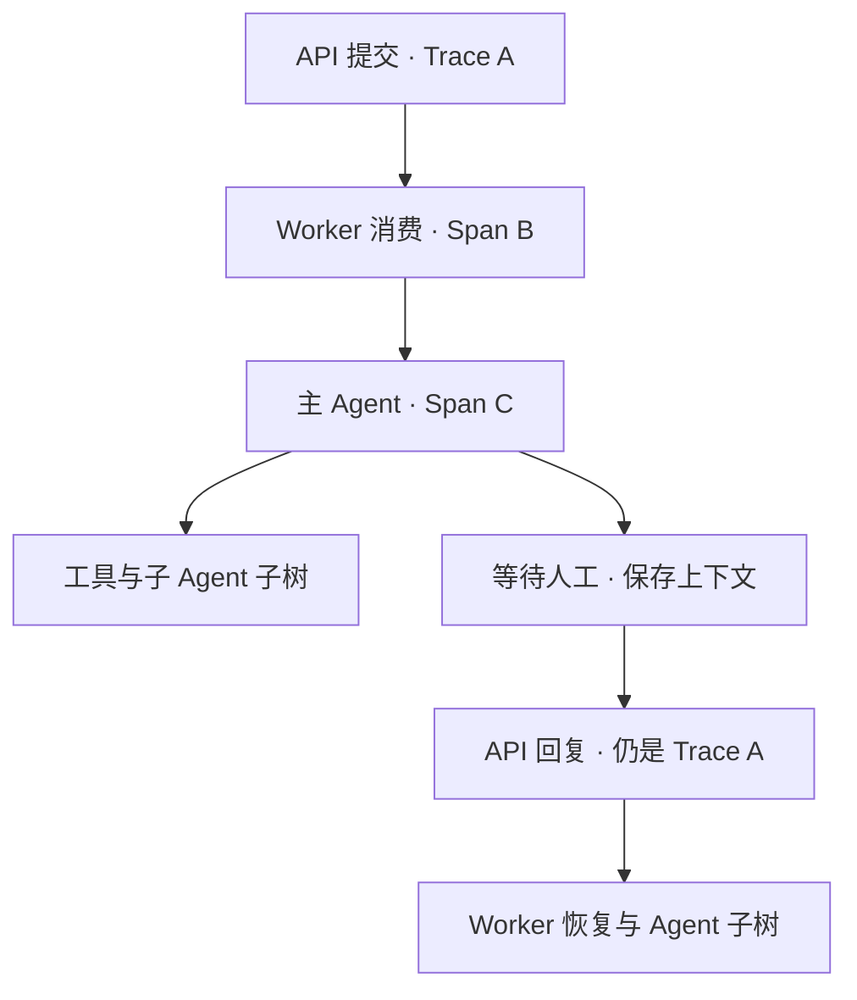

# Langfuse 分布式执行追踪

## 关联规则

一轮用户输入创建一个 Trace，API、队列接收、Worker、主 Agent 及官方回调采集的模型/工具/子图共享它。人工回复继续原 Trace，创建新 Span；执行完成后的下一条输入创建新 Trace。会话通过 session_id 聚合多个 Trace。



每个 Span 只有一个父节点。子 Agent 可能挂在委派 task 工具片段下，再包含自己的模型与工具调用，这是正常层级。不能只按一个 span_id 筛选就期待看到所有后代，应展开该节点的子树。

多条执行中输入可能合并处理，执行以实际队列来源为父节点，并给本轮消费的消息增加 Span Link。来源 API 可以有自己的 Trace，不承诺合并输入的所有 API 都强行变成同一 Trace。这是保留现有调度方式的明确边界。

## 配置

在根目录 .env 配置，示例不包含真实密钥：

```dotenv
LANGFUSE_TRACING_ENABLED=true
LANGFUSE_BASE_URL=http://你的服务地址
LANGFUSE_PUBLIC_KEY=pk-lf-替换
LANGFUSE_SECRET_KEY=sk-lf-替换
LANGFUSE_TRACING_ENVIRONMENT=development
LANGFUSE_TIMEOUT=5
```

本地 SDK 为 5.0.4；服务端需兼容 SDK 5（自托管至少 4.59.0）。初始化日志不等于服务端已收到数据。关闭开关时不初始化 SDK；本次没有修改用户 .env 或安装、升级依赖。

## 数据放在哪里

| 数据 | 位置 | 用途 |
|---|---|---|
| 业务任务和消息 | PostgreSQL | 业务事实 |
| Agent 执行现场 | Redis checkpoint | 人工恢复、历史消息、虚拟文件 |
| 执行事件 | Redis Streams 事件流 | SSE 与断线续传 |
| 追踪上下文 | Redis 的 harness:tracing 命名空间 | 原轮次 Trace/Span、输入来源 |
| Span 数据 | Langfuse | 模型、工具、子图调用排障 |

追踪上下文按租户、项目、用户、线程、任务与 attempt 隔离，只存编号，不复制资料或密码。没有短 TTL，避免人工等待期间失联；任务归档后统一删除这批技术键的机制尚待实现。Redis 技术上下文丢失或追踪不可用时继续业务，新 Trace 可能无法与旧轮次关联。

TaskContext.trace_id 是已有业务关联号，不拿来充当每轮 Langfuse trace_id。队列 trace_context 是纯 JSON 数据，只含 trace_id 与发送端 parent_span_id，没有 SDK 对象。

## 代码边界

Domain 与 ApplicationService 的业务方法未改。Application 的 TaskJob DTO 增加可选 trace_context，旧队列消息仍能读取。API 在鉴权/任务归属检查后接入；队列适配器写技术字段；Worker 包裹消费；Runtime 包裹完整异步调用和流式迭代。SSE、查询轮询、登录密码不在这次追踪范围中。

详情和可复制代码见 [本次改动](langfuse_distributed_changes.md)。

## Trace 标签与 DDD 边界

本次生产代码只修改 `src/agent_platform/infrastructure/observability/langfuse.py`。标签统一在基础设施生成与传播，复用现有 API、Worker、Runtime 入口，不改领域规则、应用用例、队列 DTO 或依赖方向。

| 标签 | 用途 |
| --- | --- |
| `agent-platform`、`workflow:task` | 平台与任务工作流 |
| `boundary:api`、`boundary:worker`、`boundary:agent` | 请求、消费、Agent 执行边界 |
| `agent:task_planning` 等 | 对应任务配置的 Agent |
| `operation:create`、`operation:message` | 创建会话、追加普通输入 |
| `operation:execute`、`operation:resume` | 新一轮执行、人工回复恢复 |
| `invocation:new_round`、`invocation:human_resume` | 区分新轮次与人工恢复片段 |
| `round:first`、`round:followup` | 当前执行为首轮或后续轮，人工恢复不增加 attempt |

原有 `task_planning`、`execute`、`resume` 等标签继续保留。环境使用原生 environment 字段筛选；任务、线程、租户、用户编号保留在 metadata，不放进标签。API 创建会话时尚无任务对象，Agent 标签由后续 Agent 执行片段补充。

使用官方 `propagate_attributes(tags=...)` 设置当前片段并向子片段传播，退出时回收当前协程作用域；LangChain 同时传 tags 与 metadata.langfuse_tags。Trace 汇总各片段标签，因此人工恢复后的同一 Trace 可能同时包含 execute 和 resume。标签不表示操作的先后顺序，也不作为任务完成度评价。

在 Trace Tags 筛选中组合 `agent:task_planning` 和 `invocation:human_resume`，可查规划 Agent 的人工恢复链路；组合 `agent:task_planning` 和 `round:followup` 可查后续轮次。只影响部署后新产生的片段，不回填历史记录。

实现定位：`infrastructure/observability/langfuse.py` 的 `_tags()` 统一分类，`observation()` 管理 SDK 标签作用域，`api()`、`agent()` 和 `_invocation_config()` 使用同一标签生成方法。

```python
    @staticmethod
    def _tags(
        task: AgentTask | None = None,
        operation: str | None = None,
        boundary: str | None = None,
    ) -> list[str]:
        """用有限分类描述执行，不将用户、任务编号或输入正文放入标签。"""
        tags = ["agent-platform", "workflow:task"]
        if boundary:
            tags.append(f"boundary:{boundary}")
        if operation:
            tags.extend([operation, f"operation:{operation}"])
        if task:
            tags.extend([task.agent, f"agent:{task.agent}"])
            if boundary == "agent":
                tags.append("round:first" if task.attempt <= 1 else "round:followup")
        if operation in {"execute", "resume"}:
            tags.append(
                "invocation:human_resume" if operation == "resume" else "invocation:new_round"
            )
        return list(dict.fromkeys(tags))
```

本次另同步 `tests/unit/test_langfuse_tracing.py`、`tests/unit/test_distributed_tracing.py`、README 与进度摘要。20 项离线追踪测试和针对性 Ruff 检查通过，覆盖标签分类、跨边界传播、并发隔离、异常与取消清理；未初始化真实 SDK 客户端或发送遥测，服务端筛选效果仍需部署后核对。

## 如何验证

1. 启动服务，从前端新建任务。浏览器 Network 中打开 tasks 的 POST 响应，查看 X-Trace-ID；控制台追踪日志也会有 trace_id、span_id 和任务/队列编号。
2. 按这个 ID 在 Langfuse 查找 API、Worker、主 Agent 节点，展开官方回调生成的模型、工具和子图。Agent 必须真的调用 task 委派工具才会出现子 Agent，追踪不会替模型创建它。
3. 触发 ask_user，记录 Trace，等待任务暂停后正常关闭后端，再启动并提交回复；resume 响应应返回相同 Trace，出现新的恢复节点。
4. 当前轮完成后再发一句话，返回新的 Trace，session_id 仍一致。
5. 两个用户并发操作，核对 task_id、user_id、session_id 没有串线。
6. 执行中提交多条补充输入，按消息来源检查链接。Span Link 由 OpenTelemetry API 写入，服务端的具体展示需实际联调确认。

## 已验证与限制

16 项离线 Python 测试覆盖队列传递、上下文恢复、回调挂载、并发隔离、合并消息来源链接、异常/取消清理、追踪故障降级及旧队列字段兼容；11 项 Node 代理测试通过，包含响应头透传；前端 TypeScript 检查通过。

没有连接真实 Langfuse、模型或数据库做端到端验收，也没有验证实际子 Agent 的服务端调用树。SDK 关闭使用后台线程，不保证一个硬性的整体 flush 截止时间。队列可靠投递、pending 消息回收和任务归档不在本次追踪改动内。
