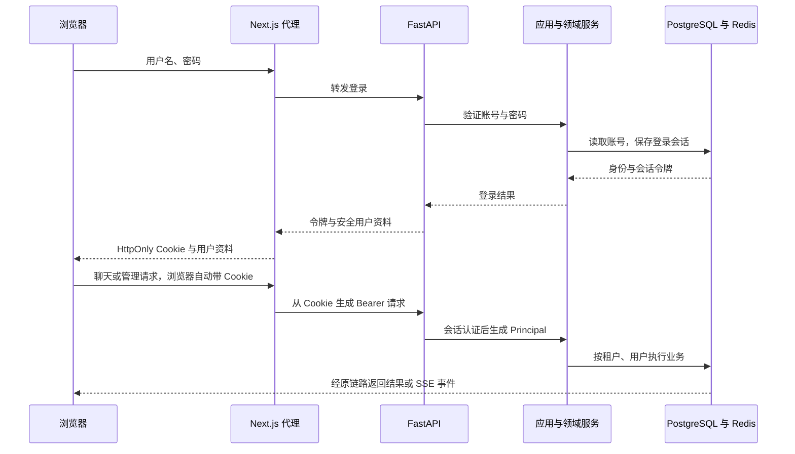

# 用户管理与登录接入

## 已实现的范围

- 用户名、密码登录，公司归属由服务端读取；本人查看身份、修改密码和退出。
- 管理员创建用户、分页查询、修改显示名称和角色、启停账号、重置密码。
- 普通用户不能管理账号；管理员只能管理本租户用户。
- 密码修改、密码重置、角色变化和账号启停使旧会话失效。
- 最后一名启用的管理员不能被停用或降级。同租户的管理写操作通过租户行锁串行维护这个约束。
- 聊天页面、任务 API、SSE 和 Worker 接入真实账号认证。

本次新增的 `sys_tenant`、`sys_user` 主键均为数据库自增 `BIGINT`，Python 对应 `int`，不使用 UUID。现有任务、消息和 checkpoint 标识沿用原有协议，没有混入本次账号模块的改造。

## 第一次启动

在项目根目录执行：

```powershell
uv sync
uv run alembic upgrade head
uv run python -m agent_platform.bootstrap.initialize_admin
```

初始化命令交互输入公司代码、公司名称、管理员登录名、显示名称和密码。公司代码和登录名使用至少 3 位的小写字母、数字及 `_.-`，首字符为字母或数字。密码为 12～128 位。没有默认管理员密码，没有公开注册或初始化 HTTP 接口。

同一公司代码只能初始化一次。重复执行不能重置已有管理员密码。

根目录 `.env` 中继续使用已有 PostgreSQL、Redis 和模型配置。认证配置由模块自己读取，可以使用以下默认值：

```dotenv
AUTH_SESSION_TTL=28800
AUTH_LOGIN_LIMIT=10
AUTH_LOGIN_WINDOW=300
```

含义分别为登录会话绝对有效秒数、单账号窗口内最多登录尝试次数、限流窗口秒数；另有来源地址维度的较高阈值。通过 Next.js 转发后，FastAPI 默认看到的是代理地址，来源地址限流属于共享保护，账号维度仍分别计数。当前不信任浏览器提交的转发地址头。

开发时沿用 API 内启动 Worker 的配置：

```dotenv
HARNESS_WORKER_ENABLED=true
HARNESS_WORKER_CONCURRENCY=1
```

若独立部署 Worker，API 设置 `HARNESS_WORKER_ENABLED=false`，另行启动 `uv run harness-worker`。

在 `frontpages/.env.local` 中配置：

```dotenv
HARNESS_API_URL=http://127.0.0.1:8000
FRONTEND_ORIGIN=http://localhost:3000
```

`FRONTEND_ORIGIN` 必须与浏览器地址精确一致。如果使用 `http://127.0.0.1:3000` 访问，应同时修改这里。正式部署填写实际 HTTPS 地址；生产 Cookie 开启 `Secure`，需要 HTTPS。修改 Next.js 环境变量后重启前端。

分别启动：

```powershell
# 项目根目录
uv run harness-api
```

```powershell
# frontpages 目录
npm run dev
```

访问 `/login`，只填写初始化账号的用户名和密码，不再填写公司代码。管理员从侧栏“用户管理”创建普通成员。点击左下角头像可进入账号设置或退出。

旧的开发令牌已退出认证链路，前端不再要求填写令牌，也不在 sessionStorage 中保存登录凭据。旧 `.env` 开发身份字段不再生效。

## 跟着代码走



令牌为随机不透明字符串，Redis 键使用令牌摘要，值只包含租户 ID、用户 ID 和凭据修订号。Redis TTL 控制绝对过期时间，不是每次请求自动续期。

`auth_revision` 仅用于使旧登录凭据失效，不是业务版本协议。每次认证还会查询当前用户和租户状态，避免旧会话继续使用旧角色。

数据库事务只包住短数据库操作。密码哈希和 Redis 操作在这些事务外执行；仓储复用 `current_session()`，不自行创建、提交或关闭 Session，也不新增数据库连接池。

## 文件与职责

以下路径均相对项目根目录。

| 层 | 文件 | 职责 |
|---|---|---|
| Domain | `src/agent_platform/domain/aggregates/user.py` | 用户聚合、角色与启用检查、凭据修订 |
| Domain | `src/agent_platform/domain/types/tenant.py` | 租户及默认工作空间信息 |
| Domain | `src/agent_platform/domain/repositories/user_repository.py` | 用户仓储抽象接口 |
| Domain | `src/agent_platform/domain/services/user_domain_service.py` | 管理员权限与最后一名管理员规则 |
| Application | `src/agent_platform/application/services/authentication_application_service.py` | 登录、身份查询、退出、修改密码、Worker 身份复核 |
| Application | `src/agent_platform/application/services/user_application_service.py` | 用户管理和初始租户创建的用例编排 |
| Application | `src/agent_platform/application/dto/authentication_dto.py` | 安全用户资料、管理列表、认证错误 |
| Application | `src/agent_platform/application/dto/user_command.py` | 命令参数与字段校验 |
| Application | `src/agent_platform/application/interfaces/login_sessions.py` | 可撤销会话契约 |
| Application | `src/agent_platform/application/interfaces/password_hasher.py` | 密码摘要契约 |
| Infrastructure | `src/agent_platform/infrastructure/persistence/entities/sys_tenant.py` | `sys_tenant` 表映射 |
| Infrastructure | `src/agent_platform/infrastructure/persistence/entities/sys_user.py` | `sys_user` 表映射 |
| Infrastructure | `src/agent_platform/infrastructure/persistence/repositories/user_repository.py` | 仓储实现与数据库读写 |
| Infrastructure | `src/agent_platform/infrastructure/security/settings.py` | 模块独立的 `AUTH_` 配置 |
| Infrastructure | `src/agent_platform/infrastructure/security/password_hasher.py` | pwdlib Argon2 密码实现 |
| Infrastructure | `src/agent_platform/infrastructure/security/redis_login_sessions.py` | Redis 会话与原子限流 |
| Interface | `src/agent_platform/interface/api/dependencies.py` | 从令牌认证用户，生成可信 Principal |
| Interface | `src/agent_platform/interface/api/routes/v1/authentication.py` | 登录、身份、退出、密码 API |
| Interface | `src/agent_platform/interface/api/routes/v1/users.py` | 管理员用户管理 API |
| Interface | `src/agent_platform/interface/vo/user_vo.py` | 请求与登录响应模型 |
| Bootstrap | `src/agent_platform/bootstrap/authentication.py` | 装配认证模块，不向 Container 注册业务服务 |
| Bootstrap | `src/agent_platform/bootstrap/initialize_admin.py` | 一次性管理员初始化命令 |
| Migration | `migrations/alembic/versions/9ab31fe02d16_add_user_accounts.py` | 新表及主键序列迁移 |
| Migration | `migrations/alembic/versions/ab8d4e21c750_unique_login_username.py` | 用户名全局唯一，升级前检查历史重名 |
| Frontend | `frontpages/src/app/login/page.tsx` | 登录页 |
| Frontend | `frontpages/src/app/admin/users/page.tsx` | 管理员页面及服务端权限保护 |
| Frontend | `frontpages/src/app/account/page.tsx` | 本人账号设置 |
| Frontend | `frontpages/src/app/api/backend/[...path]/route.ts` | Cookie 代理、接口白名单、来源校验、SSE 转发 |
| Frontend | `frontpages/src/components/admin/user-management.tsx` | 用户列表、创建、编辑、启停与重置密码 |
| Frontend | `frontpages/src/components/auth/` | 登录表单、身份上下文、账号菜单与密码表单 |
| Frontend | `frontpages/src/lib/auth-server.ts` | 服务端页面认证，不把令牌传给客户端组件 |
| Frontend | `frontpages/src/lib/auth-api.ts`、`auth-types.ts` | 客户端账号请求与数据类型 |

同时修改了 API 路由注册、异常映射、ORM 注册、资源关闭清理、Worker 装配、工作台页面、聊天请求和 SSE 读取。删除了旧的前端开发令牌设置组件。

前端复用 `components/ui` 中的 shadcn/ui 组合组件，补充 Card、Table 和 Native Select；对话框继续使用项目已有的 Radix Dialog，没有另写弹窗或下拉交互引擎。

## HTTP 接口

所有路径以 `/api/v1` 开头。

| 方法 | 路径 | 权限 |
|---|---|---|
| POST | `/auth/login` | 无需登录，有登录限流 |
| GET | `/auth/me` | 已登录 |
| POST | `/auth/logout` | 携带令牌，幂等撤销 |
| PUT | `/auth/password` | 已登录，校验当前密码 |
| GET | `/users?after_id=0&limit=20` | 本租户管理员 |
| POST | `/users` | 本租户管理员 |
| PATCH | `/users/{user_id}` | 本租户管理员 |
| POST | `/users/{user_id}/reset-password` | 本租户管理员 |

普通用户不能提升自己的权限。请求中不能传入租户 ID 或用户身份覆盖服务端认证结果。登录失败不区分账号不存在、所属公司禁用、账号禁用或密码错误。

## 对已有任务的影响

- 新账号沿用任务和记忆仓储已有的租户、用户隔离条件。
- 迁移将新租户与用户序列抬到现有任务、记忆中使用过的对应编号之后。旧测试数据不删除，也不会自动分配给新管理员。
- 退出登录会撤销当前会话，工作台离开时关闭 SSE；跨标签页退出通过 BroadcastChannel 通知。
- SSE 每 15 秒复核认证，发现失效后发送 `auth_expired` 并结束；前端返回登录页。
- Worker 开始执行或恢复前确认账号仍然启用。账号失效时取消可取消的排队任务并确认消息。
- 已经执行中的任务暂不强制中断；退出登录也不取消已接收的任务。

## 验证与限制

前端代理的 8 项 Node 本地检查通过；上游 fetch 使用替代响应，没有调用真实后端或模型。TypeScript 检查、这次新增认证界面的 lint，以及 DDD 依赖方向静态扫描通过。

后端添加了 SQLite 仓储与 HTTP 链路测试、会话撤销、租户隔离、管理员约束、改密和 Redis 适配器契约测试。首次测试发现测试夹具重复绑定 Session 工厂，已修正。修正后的后端联测被自动审批拦截：执行过程中出现发往 `dc.services.visualstudio.com` 的内容不明遥测请求；没有继续绕过限制运行，因此不能声称后端功能测试通过。

尚未对实际 PostgreSQL 执行本次迁移，也没有替你创建真实管理员。先按本文启动步骤建立账号，再验证“管理员创建成员 → 成员登录聊天 → 查看自己的历史 → 管理员停用成员 → 旧会话失效”的完整流程。

前端本地检查命令：

```powershell
# frontpages 目录
node --test tests/auth-proxy.test.cjs
npm run typecheck
```

待测试环境的外部遥测问题确认后，后端用例可运行：

```powershell
uv run pytest tests/unit/test_user_authentication.py -q
```

目前没有加入菜单级 RBAC、部门树、第三方 SSO、短信登录、公开注册或密码找回邮件。后续可按业务需求增加，保持当前用户管理链路清晰。

## 用户名登录调整

登录接口只接收 `username`、`password`。公司代码保留用于初始化和内部管理，不再作为登录输入。后端按全局唯一用户名找到用户，再通过该用户的 `tenant_id` 查询公司，继续构造原有的可信 Principal；任务、记忆和用户管理的租户过滤不变。

已有数据库需要在项目根目录执行 `uv run alembic upgrade head`，然后重启后端与前端。此次调整不升级依赖、不覆盖已有密码、不更改用户整数主键。原始建表迁移保持不变，通过新的增量迁移替换唯一约束。

若迁移提示存在重复用户名，先由维护者确认归属并为重名账号指定不同登录名，再重跑迁移；不会自动删除、合并或改名。可由数据库维护者查询：

```sql
SELECT username, COUNT(*) FROM sys_user GROUP BY username HAVING COUNT(*) > 1;
```

随后查看对应的 `id`、`tenant_id` 和 `username`，按整数主键修改明确选定的账号即可；不要修改其所属公司或历史业务数据。
